# Parcours A — Physique générale

> [!abstract] Objectif
> Culture solide, des bases aux grandes théories

**28 étapes**, niveau 1 → 4. Coche au fur et à mesure.

## Étapes

- [ ] 1. [[Analyse]] · n1 · *partiel*
- [ ] 2. [[Algèbre linéaire (fiche)|Algèbre linéaire]] · n1 · *partiel*
- [ ] 3. [[Équations différentielles]] · n1 · *à rédiger*
- [ ] 4. [[Probabilités]] · n2 · *à rédiger*
- [ ] 5. [[Trajectoires, chemins et champs]] · n1 · *partiel*
- [ ] 6. [[Mécanique du point]] · n1 · *partiel*
- [ ] 7. [[Systèmes de points]] · n2 · *partiel*
- [ ] 8. [[Mécanique du solide]] · n2 · *partiel*
- [ ] 9. [[Oscillateurs]] · n1 · *à rédiger*
- [ ] 10. [[Analyse de Fourier]] · n2 · *partiel*
- [ ] 11. [[Physique des ondes]] · n2 · *partiel*
- [ ] 12. [[Thermodynamique]] · n1 · *partiel*
- [ ] 13. [[Entropie]] · n2 · *à rédiger*
- [ ] 14. [[Électrostatique]] · n2 · *à rédiger*
- [ ] 15. [[Magnétostatique]] · n2 · *à rédiger*
- [ ] 16. [[Électromagnétisme]] · n3 · *à rédiger*
- [ ] 17. [[Principe de moindre action]] · n3 · *partiel*
- [ ] 18. [[Métrique]] · n2 · *partiel*
- [ ] 19. [[Mécanique lagrangienne]] · n3 · *partiel*
- [ ] 20. [[Relativité restreinte]] · n2 · *partiel*
- [ ] 21. [[Fondements de la mécanique quantique]] · n2 · *à rédiger*
- [ ] 22. [[Espace de Hilbert]] · n3 · *à rédiger*
- [ ] 23. [[Observable et état]] · n3 · *à rédiger*
- [ ] 24. [[Formalisme quantique]] · n3 · *à rédiger*
- [ ] 25. [[Physique statistique classique]] · n3 · *partiel*
- [ ] 26. [[Ensembles statistiques]] · n3 · *à rédiger*
- [ ] 27. [[Champs classiques]] · n3 · *partiel*
- [ ] 28. [[Théorie lagrangienne des champs]] · n4 · *à rédiger*

> [!warning]- Prérequis supposés (hors parcours)
> [[Théorème de Liouville]]

## Carte

```mermaid
flowchart TD
  n0["Analyse"]
  n1["Algèbre linéaire"]
  n2["Équations différentielles"]
  n3["Probabilités"]
  n4["Trajectoires, chemins et champs"]
  n5["Mécanique du point"]
  n6["Systèmes de points"]
  n7["Mécanique du solide"]
  n8["Oscillateurs"]
  n9["Analyse de Fourier"]
  n10["Physique des ondes"]
  n11["Thermodynamique"]
  n12["Entropie"]
  n13["Électrostatique"]
  n14["Magnétostatique"]
  n15["Électromagnétisme"]
  n16["Principe de moindre action"]
  n17["Métrique"]
  n18["Mécanique lagrangienne"]
  n19["Relativité restreinte"]
  n20["Fondements de la mécanique quantique"]
  n21["Espace de Hilbert"]
  n22["Observable et état"]
  n23["Formalisme quantique"]
  n24["Physique statistique classique"]
  n25["Ensembles statistiques"]
  n26["Champs classiques"]
  n27["Théorie lagrangienne des champs"]
  n0 --> n1
  n1 --> n2
  n2 --> n3
  n3 --> n4
  n4 --> n5
  n5 --> n6
  n6 --> n7
  n7 --> n8
  n8 --> n9
  n9 --> n10
  n10 --> n11
  n11 --> n12
  n12 --> n13
  n13 --> n14
  n14 --> n15
  n15 --> n16
  n16 --> n17
  n17 --> n18
  n18 --> n19
  n19 --> n20
  n20 --> n21
  n21 --> n22
  n22 --> n23
  n23 --> n24
  n24 --> n25
  n25 --> n26
  n26 --> n27
```

