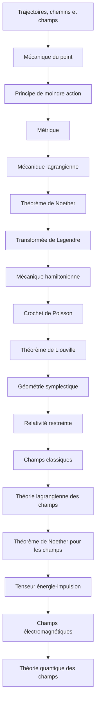

# Parcours B — De la mécanique classique à la théorie des champs

> [!abstract] Objectif
> Voir comment les principes variationnels mènent aux champs

**18 étapes**, niveau 1 → 5. Coche au fur et à mesure.

## Étapes

- [ ] 1. [[Trajectoires, chemins et champs]] · n1 · *partiel*
- [ ] 2. [[Mécanique du point]] · n1 · *partiel*
- [ ] 3. [[Principe de moindre action]] · n3 · *partiel*
- [ ] 4. [[Métrique]] · n2 · *partiel*
- [ ] 5. [[Mécanique lagrangienne]] · n3 · *partiel*
- [ ] 6. [[Théorème de Noether]] · n3 · *partiel*
- [ ] 7. [[Transformée de Legendre]] · n3 · *à rédiger*
- [ ] 8. [[Mécanique hamiltonienne]] · n3 · *partiel*
- [ ] 9. [[Crochet de Poisson]] · n3 · *partiel*
- [ ] 10. [[Théorème de Liouville]] · n3 · *partiel*
- [ ] 11. [[Géométrie symplectique]] · n4 · *à rédiger*
- [ ] 12. [[Relativité restreinte]] · n2 · *partiel*
- [ ] 13. [[Champs classiques]] · n3 · *partiel*
- [ ] 14. [[Théorie lagrangienne des champs]] · n4 · *à rédiger*
- [ ] 15. [[Théorème de Noether pour les champs]] · n4 · *partiel*
- [ ] 16. [[Tenseur énergie-impulsion]] · n4 · *à rédiger*
- [ ] 17. [[Champs électromagnétiques]] · n4 · *à rédiger*
- [ ] 18. [[Théorie quantique des champs]] · n5 · *à rédiger*

> [!warning]- Prérequis supposés (hors parcours)
> [[Analyse]] · [[Algèbre linéaire (fiche)|Algèbre linéaire]] · [[Équations différentielles]] · [[Forme différentielle]] · [[Électromagnétisme]] · [[Électrodynamique relativiste]] · [[Seconde quantification]]

## Carte

