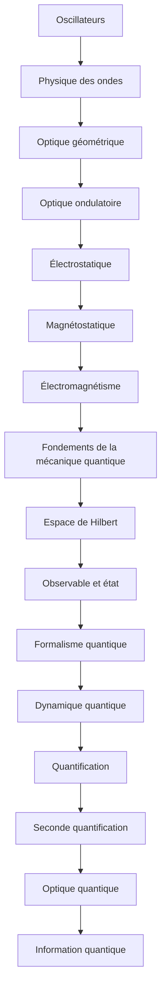

# Parcours C — De l'optique à l'optique quantique

> [!abstract] Objectif
> Relier propagation classique et description quantique de la lumière

**16 étapes**, niveau 1 → 4. Coche au fur et à mesure.

## Étapes

- [ ] 1. [[Oscillateurs]] · n1 · *à rédiger*
- [ ] 2. [[Physique des ondes]] · n2 · *partiel*
- [ ] 3. [[Optique géométrique]] · n1 · *partiel*
- [ ] 4. [[Optique ondulatoire]] · n2 · *à rédiger*
- [ ] 5. [[Électrostatique]] · n2 · *à rédiger*
- [ ] 6. [[Magnétostatique]] · n2 · *à rédiger*
- [ ] 7. [[Électromagnétisme]] · n3 · *à rédiger*
- [ ] 8. [[Fondements de la mécanique quantique]] · n2 · *à rédiger*
- [ ] 9. [[Espace de Hilbert]] · n3 · *à rédiger*
- [ ] 10. [[Observable et état]] · n3 · *à rédiger*
- [ ] 11. [[Formalisme quantique]] · n3 · *à rédiger*
- [ ] 12. [[Dynamique quantique]] · n3 · *partiel*
- [ ] 13. [[Quantification]] · n4 · *à rédiger*
- [ ] 14. [[Seconde quantification]] · n4 · *à rédiger*
- [ ] 15. [[Optique quantique]] · n4 · *à rédiger*
- [ ] 16. [[Information quantique]] · n4 · *à rédiger*

> [!warning]- Prérequis supposés (hors parcours)
> [[Équations différentielles]] · [[Analyse de Fourier]] · [[Analyse]] · [[Algèbre linéaire (fiche)|Algèbre linéaire]] · [[Mécanique du point]] · [[Mécanique hamiltonienne]]

## Carte

