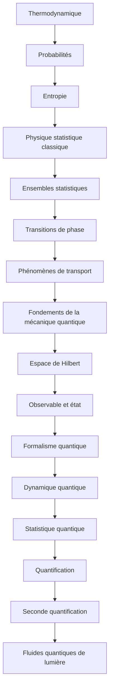

# Parcours D — De la thermodynamique aux gaz quantiques

> [!abstract] Objectif
> Comprendre les gaz quantiques depuis la thermodynamique

**16 étapes**, niveau 1 → 5. Coche au fur et à mesure.

## Étapes

- [ ] 1. [[Thermodynamique]] · n1 · *partiel*
- [ ] 2. [[Probabilités]] · n2 · *à rédiger*
- [ ] 3. [[Entropie]] · n2 · *à rédiger*
- [ ] 4. [[Physique statistique classique]] · n3 · *partiel*
- [ ] 5. [[Ensembles statistiques]] · n3 · *à rédiger*
- [ ] 6. [[Transitions de phase]] · n3 · *partiel*
- [ ] 7. [[Phénomènes de transport]] · n3 · *partiel*
- [ ] 8. [[Fondements de la mécanique quantique]] · n2 · *à rédiger*
- [ ] 9. [[Espace de Hilbert]] · n3 · *à rédiger*
- [ ] 10. [[Observable et état]] · n3 · *à rédiger*
- [ ] 11. [[Formalisme quantique]] · n3 · *à rédiger*
- [ ] 12. [[Dynamique quantique]] · n3 · *partiel*
- [ ] 13. [[Statistique quantique]] · n4 · *à rédiger*
- [ ] 14. [[Quantification]] · n4 · *à rédiger*
- [ ] 15. [[Seconde quantification]] · n4 · *à rédiger*
- [ ] 16. [[Fluides quantiques de lumière]] · n5 · *partiel*

> [!warning]- Prérequis supposés (hors parcours)
> [[Analyse]] · [[Théorème de Liouville]] · [[Physique des ondes]] · [[Mécanique du point]] · [[Algèbre linéaire (fiche)|Algèbre linéaire]] · [[Équations différentielles]] · [[Mécanique hamiltonienne]] · [[Optique non linéaire et solitons]]

## Carte

