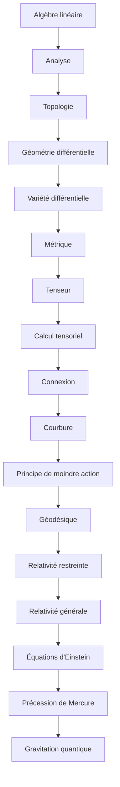

# Parcours E — De la géométrie à la relativité générale

> [!abstract] Objectif
> Formulation géométrique de la gravitation

**17 étapes**, niveau 1 → 5. Coche au fur et à mesure.

## Étapes

- [ ] 1. [[Algèbre linéaire (fiche)|Algèbre linéaire]] · n1 · *partiel*
- [ ] 2. [[Analyse]] · n1 · *partiel*
- [ ] 3. [[Topologie]] · n3 · *à rédiger*
- [ ] 4. [[Géométrie différentielle]] · n3 · *partiel*
- [ ] 5. [[Variété différentielle]] · n3 · *à rédiger*
- [ ] 6. [[Métrique]] · n2 · *partiel*
- [ ] 7. [[Tenseur]] · n3 · *partiel*
- [ ] 8. [[Calcul tensoriel]] · n3 · *partiel*
- [ ] 9. [[Connexion]] · n4 · *partiel*
- [ ] 10. [[Courbure]] · n4 · *partiel*
- [ ] 11. [[Principe de moindre action]] · n3 · *partiel*
- [ ] 12. [[Géodésique]] · n3 · *à rédiger*
- [ ] 13. [[Relativité restreinte]] · n2 · *partiel*
- [ ] 14. [[Relativité générale]] · n4 · *à rédiger*
- [ ] 15. [[Équations d'Einstein]] · n4 · *partiel*
- [ ] 16. [[Précession de Mercure]] · n4 · *partiel*
- [ ] 17. [[Gravitation quantique]] · n5 · *à rédiger*

> [!warning]- Prérequis supposés (hors parcours)
> [[Trajectoires, chemins et champs]] · [[Mécanique du point]] · [[Problème de Kepler]] · [[Théorie quantique des champs]]

## Carte

