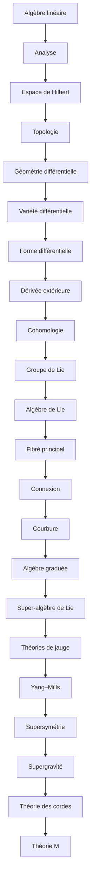

# Parcours F — Mathématiques et physique théorique avancée

> [!abstract] Objectif
> Outils mathématiques des théories avancées

**22 étapes**, niveau 1 → 5. Coche au fur et à mesure.

## Étapes

- [ ] 1. [[Algèbre linéaire (fiche)|Algèbre linéaire]] · n1 · *partiel*
- [ ] 2. [[Analyse]] · n1 · *partiel*
- [ ] 3. [[Espace de Hilbert]] · n3 · *à rédiger*
- [ ] 4. [[Topologie]] · n3 · *à rédiger*
- [ ] 5. [[Géométrie différentielle]] · n3 · *partiel*
- [ ] 6. [[Variété différentielle]] · n3 · *à rédiger*
- [ ] 7. [[Forme différentielle]] · n3 · *partiel*
- [ ] 8. [[Dérivée extérieure]] · n3 · *partiel*
- [ ] 9. [[Cohomologie]] · n4 · *à rédiger*
- [ ] 10. [[Groupe de Lie]] · n3 · *à rédiger*
- [ ] 11. [[Algèbre de Lie]] · n3 · *à rédiger*
- [ ] 12. [[Fibré principal]] · n4 · *partiel*
- [ ] 13. [[Connexion]] · n4 · *partiel*
- [ ] 14. [[Courbure]] · n4 · *partiel*
- [ ] 15. [[Algèbre graduée (fiche)|Algèbre graduée]] · n4 · *partiel*
- [ ] 16. [[Super-algèbre de Lie (fiche)|Super-algèbre de Lie]] · n5 · *partiel*
- [ ] 17. [[Théories de jauge]] · n4 · *partiel*
- [ ] 18. [[Yang–Mills]] · n5 · *à rédiger*
- [ ] 19. [[Supersymétrie]] · n5 · *partiel*
- [ ] 20. [[Supergravité (fiche)|Supergravité]] · n5 · *partiel*
- [ ] 21. [[Théorie des cordes]] · n5 · *à rédiger*
- [ ] 22. [[Théorie M]] · n5 · *partiel*

> [!warning]- Prérequis supposés (hors parcours)
> [[Tenseur]] · [[Champs électromagnétiques]] · [[Théorie quantique des champs]] · [[Relativité générale]]

## Carte

