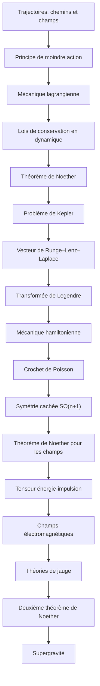

# Parcours G — Le fil de Noether

> [!abstract] Objectif
> Une seule idée (symétrie ⇒ conservation) de la trajectoire à la supergravité

**17 étapes**, niveau 1 → 5. Coche au fur et à mesure.

## Étapes

- [ ] 1. [[Trajectoires, chemins et champs]] · n1 · *partiel*
- [ ] 2. [[Principe de moindre action]] · n3 · *partiel*
- [ ] 3. [[Mécanique lagrangienne]] · n3 · *partiel*
- [ ] 4. [[Lois de conservation en dynamique]] · n2 · *partiel*
- [ ] 5. [[Théorème de Noether]] · n3 · *partiel*
- [ ] 6. [[Problème de Kepler]] · n3 · *partiel*
- [ ] 7. [[Vecteur de Runge–Lenz–Laplace]] · n3 · *partiel*
- [ ] 8. [[Transformée de Legendre]] · n3 · *à rédiger*
- [ ] 9. [[Mécanique hamiltonienne]] · n3 · *partiel*
- [ ] 10. [[Crochet de Poisson]] · n3 · *partiel*
- [ ] 11. [[Symétrie cachée SO(n+1)]] · n4 · *partiel*
- [ ] 12. [[Théorème de Noether pour les champs]] · n4 · *partiel*
- [ ] 13. [[Tenseur énergie-impulsion]] · n4 · *à rédiger*
- [ ] 14. [[Champs électromagnétiques]] · n4 · *à rédiger*
- [ ] 15. [[Théories de jauge]] · n4 · *partiel*
- [ ] 16. [[Deuxième théorème de Noether]] · n5 · *à rédiger*
- [ ] 17. [[Supergravité (fiche)|Supergravité]] · n5 · *partiel*

> [!warning]- Prérequis supposés (hors parcours)
> [[Analyse]] · [[Algèbre linéaire (fiche)|Algèbre linéaire]] · [[Mécanique du point]] · [[Métrique]] · [[Systèmes de points]] · [[Gravitation classique]] · [[Algèbre de Lie]] · [[Théorie lagrangienne des champs]] · [[Électrodynamique relativiste]] · [[Connexion]] · [[Groupe de Lie]] · [[Supersymétrie]] · [[Relativité générale]]

## Carte

