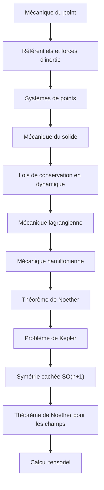

# Parcours H — Déjà rédigé : Mécanique du Solide I → VIII

> [!abstract] Objectif
> Relire dans l'ordre ce que ton vault contient déjà

**12 étapes**, niveau 1 → 4. Coche au fur et à mesure.

## Étapes

- [ ] 1. [[Mécanique du point]] · n1 · *partiel*
- [ ] 2. [[Référentiels et forces d'inertie]] · n2 · *partiel*
- [ ] 3. [[Systèmes de points]] · n2 · *partiel*
- [ ] 4. [[Mécanique du solide]] · n2 · *partiel*
- [ ] 5. [[Lois de conservation en dynamique]] · n2 · *partiel*
- [ ] 6. [[Mécanique lagrangienne]] · n3 · *partiel*
- [ ] 7. [[Mécanique hamiltonienne]] · n3 · *partiel*
- [ ] 8. [[Théorème de Noether]] · n3 · *partiel*
- [ ] 9. [[Problème de Kepler]] · n3 · *partiel*
- [ ] 10. [[Symétrie cachée SO(n+1)]] · n4 · *partiel*
- [ ] 11. [[Théorème de Noether pour les champs]] · n4 · *partiel*
- [ ] 12. [[Calcul tensoriel]] · n3 · *partiel*

> [!warning]- Prérequis supposés (hors parcours)
> [[Trajectoires, chemins et champs]] · [[Équations différentielles]] · [[Principe de moindre action]] · [[Métrique]] · [[Transformée de Legendre]] · [[Gravitation classique]] · [[Vecteur de Runge–Lenz–Laplace]] · [[Crochet de Poisson]] · [[Algèbre de Lie]] · [[Théorie lagrangienne des champs]] · [[Tenseur]] · [[Géométrie différentielle]]

## Carte

