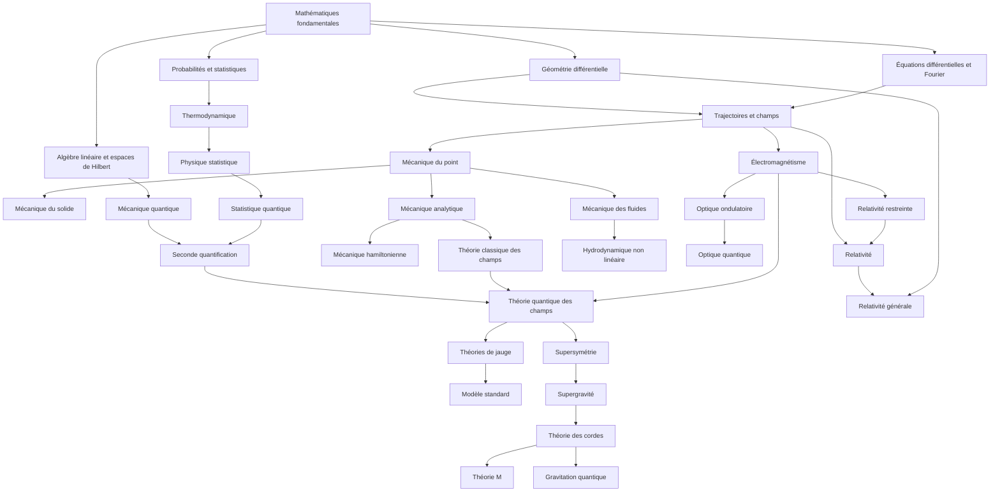

# Encyclopédie progressive de physique

> [!abstract] Objectif du projet
> Construire une encyclopédie de physique progressive, modulaire et interconnectée. Elle doit pouvoir être lue comme un livre classique, mais aussi proposer plusieurs parcours selon le domaine, le niveau ou la question étudiée.
>
> **Principe central :** un même corpus de chapitres, plusieurs chemins de lecture.

Ce fichier est le **document maître** du projet. Il rassemble l'architecture générale, les domaines, les chapitres envisagés, les liens conceptuels, les parcours de lecture et les conventions d'organisation dans Obsidian et Quartz.

Il s'agit d'une première architecture de travail : les chapitres, prérequis et relations devront être précisés au fur et à mesure de la rédaction.

---

## 1. Principes de conception

Le projet ne doit pas être organisé comme un simple arbre. La physique est un réseau de notions qui se recoupent : la mécanique analytique intervient dans plusieurs théories, les équations de Maxwell relient électromagnétisme, optique et théorie des champs, et les espaces de Hilbert sont utilisés en mécanique quantique comme en théorie de l'information quantique.

Il faut donc distinguer trois structures complémentaires :

1. **Structure pédagogique** — dans quel ordre apprendre les notions ?
2. **Structure conceptuelle** — quelles notions et théories sont liées ?
3. **Structure documentaire** — dans quels fichiers ranger les contenus ?

Le modèle recommandé est un **graphe de connaissances** accompagné d'une hiérarchie de domaines et de chapitres. Les dépendances pédagogiques peuvent former un graphe orienté acyclique (DAG), tandis que les relations conceptuelles peuvent être réciproques et former des cycles.

### Trois niveaux de granularité

| Niveau | Exemple | Rôle |
|---|---|---|
| Domaine | Mécanique quantique | Regrouper un vaste ensemble de connaissances |
| Chapitre | Formalisme de Dirac | Développer un sujet cohérent |
| Notion | Espace de Hilbert | Définir une notion précise, réutilisable dans plusieurs chapitres |

Une notion transversale doit être expliquée de manière complète à un endroit de référence, puis réutilisée par des liens Obsidian plutôt que recopiée intégralement.

### Principes pédagogiques

- Progressivité : partir des notions élémentaires et introduire les outils avancés au moment où ils deviennent nécessaires.
- Modularité : chaque chapitre doit pouvoir être étudié indépendamment, sous réserve de ses prérequis.
- Réutilisation : une notion commune ne doit pas être définie plusieurs fois.
- Transparence : les prérequis, prolongements et liens transversaux doivent être explicites.
- Pluralité des parcours : un même chapitre peut appartenir à plusieurs parcours.
- Distinction entre prérequis stricts et simples approfondissements conseillés.

---

## 2. Architecture générale

Le cours est organisé en huit grandes parties.

1. **Fondements mathématiques et conceptuels**
2. **Mécanique classique**
3. **Ondes, optique et électromagnétisme**
4. **Thermodynamique et physique statistique**
5. **Mécanique quantique**
6. **Relativité et gravitation**
7. **Théories des champs**
8. **Physique théorique avancée**

Cette hiérarchie est une structure de rangement et de navigation. Elle ne représente pas à elle seule toutes les dépendances entre les sujets.

---

# 3. Domaines et chapitres

## I. Fondements mathématiques et conceptuels

Cette partie fournit le langage commun utilisé dans les différentes théories physiques.

| Chapitre | Contenu envisagé |
|---|---|
| Langage mathématique | Ensembles, applications, relations, structures |
| Algèbre linéaire | Espaces vectoriels, bases, applications linéaires, dualité, tenseurs |
| Analyse | Suites, limites, dérivées, intégrales, séries |
| Équations différentielles | Équations différentielles ordinaires, systèmes dynamiques |
| Analyse fonctionnelle | Espaces normés, espaces de Banach et de Hilbert, opérateurs, distributions |
| Géométrie | Espaces affines, euclidiens, métriques |
| Géométrie différentielle | Courbes, surfaces, variétés, champs, formes différentielles |
| Calcul tensoriel | Tenseurs, changement de coordonnées, dérivées covariantes, courbure |
| Équations aux dérivées partielles | Équations elliptiques, paraboliques et hyperboliques |
| Analyse de Fourier | Séries et transformées de Fourier, spectres |
| Probabilités | Variables aléatoires, lois, distributions, processus stochastiques |
| Groupes et symétries | Groupes, groupes de Lie, algèbres de Lie, représentations |
| Topologie | Continuité, connexité, homotopie, invariants topologiques |
| Cohomologie | Cohomologie de de Rham et autres constructions utiles en physique |

### Chapitre transversal : trajectoires, chemins et champs

La notion de trajectoire peut constituer une excellente entrée dans la physique, car elle permet de présenter plusieurs structures mathématiques et physiques avec un même vocabulaire.

Pistes de développement :

- Trajectoire comme courbe dans un espace.
- Courbe paramétrée par le temps.
- Mouvement comme application d'un intervalle temporel vers un espace de configuration.
- Trajectoire dans l'espace des configurations.
- Trajectoire dans l'espace des phases.
- Trajectoire comme solution d'une équation différentielle.
- Trajectoire comme extremum d'une action.
- Chemin dans l'espace-temps.
- Ligne de champ et ligne de courant.
- Évolution d'un état dans un espace de Hilbert.
- Distinction entre trajectoire physique, chemin géométrique et histoire dynamique.

Notions à relier :

| Notion | Développements et domaines liés |
|---|---|
| Trajectoire | Géométrie différentielle, cinématique, systèmes dynamiques |
| Principe variationnel | Mécanique analytique, théorie des champs |
| Principe de Hamilton-Cartan | Formulations géométriques et variationnelles de la mécanique |
| Formes différentielles | Intégrales curvilignes, circulation, flux, théorèmes de Stokes |
| Champs vectoriels | Dynamique, électromagnétisme, mécanique des fluides |
| Champs tensoriels | Relativité générale, milieux continus |
| Équations de Maxwell | Électromagnétisme, optique, théorie des champs |

Le principe de Cartan, les formes différentielles et les champs de Maxwell pourront être introduits dans ce chapitre transversal, puis développés dans leurs chapitres spécialisés.

## II. Mécanique classique

| Chapitre | Contenu envisagé |
|---|---|
| Mécanique du point | Cinématique, dynamique, lois de Newton, travail et énergie |
| Systèmes de points | Centre de masse, référentiels, collisions, systèmes à plusieurs corps |
| Gravitation classique | Loi de Newton, potentiel gravitationnel, orbites |
| Mécanique du solide | Cinématique du solide, torseurs, centre d'inertie, tenseur d'inertie, rotation |
| Mécanique analytique | Principe de moindre action, lagrangien, équations d'Euler-Lagrange |
| Mécanique hamiltonienne | Espace des phases, hamiltonien, crochets de Poisson |
| Systèmes intégrables | Intégrales premières, variables action-angle, intégrabilité |
| Systèmes dynamiques non linéaires | Stabilité, bifurcations, chaos |
| Mécanique des milieux continus | Déformations, contraintes, lois constitutives, élasticité |
| Mécanique des fluides | Hydrostatique, équations d'Euler, Navier-Stokes, écoulements |

## III. Ondes, optique et électromagnétisme

| Chapitre | Contenu envisagé |
|---|---|
| Oscillateurs | Oscillateur harmonique, amortissement, résonance |
| Physique des ondes | Équation d'onde, propagation, interférences, dispersion |
| Ondes non linéaires | Équations non linéaires, solitons |
| Optique géométrique | Rayons, réflexion, réfraction, lentilles, instruments |
| Optique ondulatoire | Diffraction, interférences, polarisation |
| Électrostatique | Charges, champ électrique, potentiel, équations de Poisson et Laplace |
| Magnétostatique | Courants, champ magnétique, lois fondamentales |
| Induction électromagnétique | Induction, loi de Faraday, énergie |
| Électromagnétisme | Équations de Maxwell, énergie, impulsion, rayonnement |
| Optique électromagnétique | Propagation, milieux matériels, dispersion |
| Physique non linéaire | Optique non linéaire, effet Kerr, génération d'harmoniques |

## IV. Thermodynamique et physique statistique

| Chapitre | Contenu envisagé |
|---|---|
| Thermodynamique | Variables d'état, transformations, premier principe |
| Entropie | Deuxième principe, irréversibilité |
| Potentiels thermodynamiques | Énergie libre, enthalpie, potentiel chimique |
| Physique statistique classique | Microétats, macroétats, distributions |
| Ensembles statistiques | Microcanonique, canonique, grand canonique |
| Transitions de phase | Paramètres d'ordre, phénomènes critiques |
| Physique statistique quantique | Statistiques de Bose-Einstein et de Fermi-Dirac |
| Systèmes hors équilibre | Cinétique, transport, hydrodynamique |
| Thermodynamique de l'information | Entropie informationnelle, information physique |

## V. Mécanique quantique

| Chapitre | Contenu envisagé |
|---|---|
| Fondements de la mécanique quantique | Expériences fondatrices, dualité onde-corpuscule |
| Formalisme quantique | États, espaces de Hilbert, observables |
| Dynamique quantique | Équation de Schrödinger, évolution temporelle |
| Formalisme opératoriel | Commutateurs, spectres, mesure |
| Moment cinétique | Spin, moment cinétique orbital, addition des moments |
| Systèmes à plusieurs particules | Particules identiques, symétrisation et antisymétrisation |
| Méthodes d'approximation | Perturbations, méthode variationnelle |
| Quantification | Quantification canonique, intégrale de chemin |
| Seconde quantification | Opérateurs de création et d'annihilation, espaces de Fock |
| Optique quantique | États cohérents, photons, interaction lumière-matière |
| Information quantique | Qubits, intrication, mesures, canaux quantiques |
| Systèmes quantiques ouverts | Décohérence, matrices densité, équations maîtresses |

**Point de vocabulaire à stabiliser :** distinguer la quantification d'un système classique, la quantification canonique, la quantification par intégrale de chemin et la seconde quantification. Ces notions sont liées, mais ne sont pas synonymes.

## VI. Relativité et gravitation

| Chapitre | Contenu envisagé |
|---|---|
| Relativité galiléenne | Changements de référentiels, transformations galiléennes |
| Relativité restreinte | Transformations de Lorentz, espace-temps, quadrivecteurs |
| Mécanique relativiste | Énergie, impulsion, dynamique |
| Électrodynamique relativiste | Quadrivecteurs et tenseur électromagnétique |
| Gravitation newtonienne | Potentiel gravitationnel, équation de Poisson |
| Relativité générale | Principe d'équivalence, métrique, géométrie de l'espace-temps |
| Géométrie de l'espace-temps | Connexion, géodésiques, tenseur de courbure |
| Équations d'Einstein | Dynamique gravitationnelle, sources et géométrie |
| Astrophysique relativiste | Trous noirs, ondes gravitationnelles |
| Cosmologie | Modèles cosmologiques, expansion, univers primordial |

## VII. Théories des champs

Cette partie rassemble plusieurs outils développés dans la mécanique analytique, l'électromagnétisme, la relativité et la mécanique quantique.

| Chapitre | Contenu envisagé |
|---|---|
| Champs classiques | Champs scalaires, vectoriels et tensoriels |
| Théorie lagrangienne des champs | Densité lagrangienne, action, équations d'Euler-Lagrange des champs |
| Symétries continues | Théorème de Noether, courants et charges conservés |
| Champs électromagnétiques | Formulation lagrangienne de Maxwell |
| Quantification des champs | Passage des champs classiques aux champs quantiques |
| Théorie quantique des champs | Champs scalaires, fermions, opérateurs, propagateurs |
| Diagrammes de Feynman | Interactions, amplitudes de diffusion |
| Théories de jauge | Groupes de jauge, champs de Yang-Mills |
| Renormalisation | Régularisation, renormalisation, groupe de renormalisation |
| Théories effectives | Échelles d'énergie, description effective |
| Modèle standard | QED, QCD, interaction électrofaible |

## VIII. Physique théorique avancée

| Chapitre | Contenu envisagé |
|---|---|
| Topologie et physique | Invariants topologiques, nombres de Chern |
| Cohomologie | Cohomologie de de Rham, applications aux champs |
| Théories topologiques des champs | Théorie de Chern-Simons, invariants |
| Supersymétrie | Algèbre supersymétrique, supermultiplets |
| Supergravité | Gravitation et supersymétrie |
| Théorie des cordes | Cordes bosoniques, supercordes |
| Théorie M | Dimensions supplémentaires, dualités |
| Gravitation quantique | Approches canoniques, gravitation quantique à boucles, approches issues des cordes |

---

## 4. Domaines complémentaires à intégrer

La première liste de domaines n'est pas exhaustive. Les domaines suivants sont à ajouter au graphe global et à organiser progressivement.

- Physique atomique et moléculaire.
- Physique nucléaire.
- Physique des particules.
- Physique de la matière condensée.
- Physique des plasmas.
- Physique des systèmes complexes.
- Physique mésoscopique.
- Théorie de l'information classique.
- Théorie des systèmes dynamiques.
- Cosmologie.
- Physique mathématique.

Ces domaines ne doivent pas nécessairement former une nouvelle grande partie chacun. Certains seront des branches spécialisées, d'autres des domaines transversaux.

---

# 5. Graphe global des dépendances

Le diagramme suivant est volontairement simplifié. Il donne une première vue des grandes filiations pédagogiques. Il ne remplace pas les liens transversaux entre notions.



### Liens transversaux à développer explicitement

| Domaine A | Domaine B | Relation à étudier |
|---|---|---|
| Mécanique analytique | Relativité générale | Formulations variationnelles et hamiltoniennes |
| Mécanique hamiltonienne | Mécanique quantique | Quantification et correspondance classique-quantique |
| Physique statistique | Théorie de l'information | Entropie, information et ensembles |
| Équations de Maxwell | Théories de jauge | Potentiels, invariance de jauge, champs |
| Cohomologie | Théorie des champs | Structures géométriques et topologiques |
| Physique non linéaire | Mécanique des fluides | Instabilités, turbulence, structures cohérentes |
| Physique non linéaire | Optique | Propagation non linéaire, solitons |
| Seconde quantification | Physique statistique quantique | Gaz de bosons et de fermions |
| Relativité générale | Théorie quantique des champs | Champs quantiques en espace-temps courbe |
| Théorie de l'information | Information quantique | Généralisation quantique des concepts informationnels |

---

# 6. Parcours de lecture

Les parcours utilisent les mêmes chapitres, mais dans des ordres différents. Ils doivent préciser les prérequis stricts, les étapes recommandées et les objectifs d'apprentissage.

## Parcours A — Physique générale

**Objectif :** construire une culture générale solide en physique, des bases jusqu'aux grandes théories.

1. Langage mathématique.
2. Analyse et algèbre linéaire.
3. Cinématique et trajectoires.
4. Mécanique du point.
5. Mécanique du solide.
6. Oscillateurs et ondes.
7. Thermodynamique.
8. Électromagnétisme.
9. Mécanique analytique.
10. Relativité restreinte.
11. Mécanique quantique.
12. Physique statistique.
13. Théories des champs.

## Parcours B — De la mécanique classique à la théorie des champs

**Objectif :** comprendre comment les principes variationnels de la mécanique conduisent aux théories des champs.

1. Trajectoires et espaces de configurations.
2. Mécanique du point.
3. Principe variationnel.
4. Mécanique lagrangienne.
5. Mécanique hamiltonienne.
6. Géométrie symplectique.
7. Théorie classique des champs.
8. Équations de Maxwell.
9. Relativité restreinte.
10. Théorie quantique des champs.

## Parcours C — De l'optique à l'optique quantique

**Objectif :** relier la propagation classique des ondes à la description quantique de la lumière.

1. Oscillateurs.
2. Équation d'onde.
3. Optique géométrique.
4. Optique ondulatoire.
5. Électromagnétisme.
6. Quantification du champ électromagnétique.
7. Photons.
8. États cohérents.
9. Optique quantique.
10. Information quantique.

## Parcours D — De la thermodynamique aux gaz quantiques

**Objectif :** comprendre les gaz quantiques à partir de la thermodynamique et de la physique statistique.

1. Thermodynamique.
2. Probabilités.
3. Physique statistique classique.
4. Ensembles statistiques.
5. Physique statistique quantique.
6. Statistique de Bose-Einstein.
7. Statistique de Fermi-Dirac.
8. Seconde quantification.
9. Gaz de Bose et de Fermi.
10. Systèmes quantiques hors équilibre.
11. Hydrodynamique quantique.

## Parcours E — De la géométrie à la relativité générale

**Objectif :** comprendre la formulation géométrique de la gravitation.

1. Géométrie euclidienne.
2. Géométrie différentielle.
3. Calcul tensoriel.
4. Relativité restreinte.
5. Géométrie de l'espace-temps.
6. Principe d'équivalence.
7. Géodésiques.
8. Courbure.
9. Équations d'Einstein.
10. Gravitation relativiste.
11. Gravitation quantique.

## Parcours F — Mathématiques et physique théorique avancée

**Objectif :** acquérir les outils mathématiques nécessaires aux théories avancées.

1. Algèbre linéaire.
2. Analyse fonctionnelle.
3. Variétés différentielles.
4. Formes différentielles.
5. Topologie.
6. Groupes de Lie.
7. Cohomologie.
8. Théorie des champs.
9. Théories de jauge.
10. Supersymétrie.
11. Supergravité.
12. Théorie des cordes.
13. Théorie M.

---

# 7. Organisation documentaire Obsidian et Quartz

## Arborescence proposée

```text
Physique/
│
├── 00 - Accueil/
│   ├── Index.md
│   ├── Graphe_global.md
│   ├── Parcours_de_lecture.md
│   └── Glossaire.md
│
├── 01 - Fondements/
│   ├── Mathematiques/
│   ├── Geometrie/
│   ├── Analyse_fonctionnelle/
│   └── Trajectoires_et_champs/
│
├── 02 - Mecanique_classique/
│   ├── Mecanique_du_point/
│   ├── Mecanique_du_solide/
│   ├── Mecanique_analytique/
│   ├── Mecanique_hamiltonienne/
│   └── Gravitation_classique/
│
├── 03 - Ondes_et_champs/
│   ├── Oscillations/
│   ├── Physique_des_ondes/
│   ├── Optique/
│   ├── Electromagnetisme/
│   └── Physique_non_lineaire/
│
├── 04 - Thermodynamique_et_statistique/
│
├── 05 - Physique_quantique/
│   ├── Mecanique_quantique/
│   ├── Quantification/
│   ├── Seconde_quantification/
│   ├── Optique_quantique/
│   └── Information_quantique/
│
├── 06 - Relativite_et_gravitation/
│
├── 07 - Theorie_des_champs/
│
├── 08 - Physique_theorique_avancee/
│   ├── Topologie/
│   ├── Cohomologie/
│   ├── Supersymetrie/
│   ├── Supergravite/
│   ├── Theorie_des_cordes/
│   └── Theorie_M/
│
└── 09 - Parcours/
    ├── Physique_generale.md
    ├── Mecanique_vers_theorie_des_champs.md
    ├── Optique_quantique.md
    ├── Gaz_quantiques.md
    ├── Relativite_generale.md
    └── Theorie_des_champs.md
```

Cette arborescence est indicative. Les liens `[[...]]` sont plus importants que le rangement physique dans les dossiers : un chapitre doit pouvoir être retrouvé depuis plusieurs domaines et parcours.

## Convention de nommage

- Utiliser un nom de fichier stable, explicite et relativement court.
- Éviter de créer deux notes différentes pour une même notion.
- Employer les liens internes Obsidian `[[Nom de la note]]`.
- Conserver les accents dans les titres affichés ; choisir une convention cohérente pour les noms de fichiers.
- Utiliser les propriétés YAML pour les métadonnées, plutôt que de coder les relations uniquement dans le texte.
- Ne pas utiliser les dossiers comme unique système de classification.

## Modèle de note pour un chapitre

À copier pour chaque nouveau chapitre :

```yaml
---
title: "Mécanique analytique"
type: chapter
domain: "Mécanique classique"
level: advanced
status: planned
prerequisites:
  - "[[Mécanique du point]]"
  - "[[Calcul différentiel]]"
related:
  - "[[Principe de moindre action]]"
  - "[[Mécanique hamiltonienne]]"
  - "[[Théorie classique des champs]]"
paths:
  - "[[Physique générale]]"
  - "[[Mécanique vers théorie des champs]]"
tags:
  - physique
  - mecanique
---

# Mécanique analytique

## 1. Objectifs

## 2. Prérequis

## 3. Introduction

## 4. Développement théorique

## 5. Démonstrations

## 6. Exemples physiques

## 7. Applications

## 8. Limites et domaines de validité

## 9. Liens avec les autres théories

## 10. Exercices

## Prérequis
- [[Mécanique du point]]
- [[Calcul différentiel]]

## Pour continuer
- [[Mécanique hamiltonienne]]
- [[Théorie classique des champs]]
```

Adapter les sections au sujet : ce modèle est un point de départ, pas une obligation rigide.

## Modèle de note pour une notion transversale

```yaml
---
title: "Espace de Hilbert"
type: concept
level: intermediate
status: planned
domains:
  - "[[Mécanique quantique]]"
  - "[[Information quantique]]"
  - "[[Théorie quantique des champs]]"
related:
  - "[[Algèbre linéaire]]"
  - "[[Analyse fonctionnelle]]"
tags:
  - physique
  - mathematiques
  - notion-transversale
---

# Espace de Hilbert

## Définition

## Intuition géométrique

## Propriétés mathématiques

## Exemples

## Rôle en physique

## Utilisation dans les différents domaines

## Liens
- [[Mécanique quantique]]
- [[Information quantique]]
- [[Théorie quantique des champs]]
```

---

# 8. Navigation envisagée sur le site Quartz

Le site pourra proposer trois portes d'entrée complémentaires.

## A. Navigation par parcours

Le lecteur choisit un objectif ou un itinéraire :

- Physique générale.
- Mécanique analytique.
- Optique quantique.
- Gaz quantiques.
- Relativité générale.
- Théorie des champs.

Chaque parcours affiche l'ordre conseillé, les prérequis, les chapitres terminés et les étapes suivantes.

## B. Navigation par domaines

Le lecteur explore la hiérarchie des huit grandes parties et leurs sous-domaines.

## C. Navigation par notions

Le lecteur part d'une notion transversale :

- Trajectoire.
- Action.
- Symétrie.
- Conservation.
- Champ.
- Onde.
- Quantification.
- Entropie.
- Courbure.
- Information.

Chaque notion renvoie vers ses définitions, ses applications et les chapitres qui l'utilisent.

### Fonctionnalités possibles

- Graphe global des connaissances.
- Graphe local autour d'une notion ou d'un chapitre.
- Recherche plein texte.
- Index par domaine, niveau et type de contenu.
- Pages de parcours avec progression.
- Pages de glossaire.
- Liens « prérequis », « approfondir » et « notions associées ».

---

# 9. Méthode de développement du projet

Ne pas commencer par rédiger tous les cours. Construire d'abord l'architecture et vérifier les dépendances.

1. **Construire le graphe global** : domaines, sous-domaines, chapitres et notions.
2. **Définir les chapitres** : déterminer ce qui mérite une note indépendante.
3. **Définir les prérequis** : distinguer prérequis indispensables et connaissances utiles.
4. **Définir les liens transversaux** : identifier les notions réutilisées dans plusieurs théories.
5. **Construire les parcours** : ordonner les chapitres selon différents objectifs.
6. **Créer les fichiers Obsidian** : notes, index, modèles et métadonnées.
7. **Publier avec Quartz** : graphe, recherche, index et parcours.
8. **Rédiger progressivement** : commencer par les fondements et compléter les branches au fil du temps.

---

# 10. Décisions à prendre et points à vérifier

Cette section sert de carnet de pilotage. Elle permet de ne pas confondre les idées initiales avec les décisions déjà arrêtées.

## Décisions de conception retenues provisoirement

- [x] Construire une encyclopédie progressive plutôt qu'un livre à parcours unique.
- [x] Utiliser une hiérarchie de domaines et un graphe de connaissances.
- [x] Distinguer domaines, chapitres et notions transversales.
- [x] Prévoir plusieurs parcours de lecture.
- [x] Utiliser Obsidian pour la rédaction et les liens internes.
- [x] Utiliser Quartz pour publier le contenu.
- [ ] Valider définitivement les huit grandes parties.
- [ ] Stabiliser la convention de nommage des notes.
- [ ] Définir les niveaux de difficulté.
- [ ] Définir un format commun pour les prérequis et les relations.
- [ ] Déterminer les fonctionnalités Quartz à implémenter.

## Questions scientifiques et pédagogiques à traiter

- Quelle place donner aux mathématiques : cours autonome ou outils introduits au fil des chapitres ?
- Faut-il séparer clairement mécanique analytique, géométrie symplectique et théorie des champs ?
- Comment présenter le principe de Hamilton-Cartan et les formulations géométriques de la mécanique ?
- Comment distinguer quantification canonique, intégrale de chemin et seconde quantification ?
- Où placer la théorie de l'information classique par rapport à la physique statistique ?
- Comment articuler relativité générale, théorie quantique des champs en espace-temps courbe et gravitation quantique ?
- Quels sujets avancés doivent être présentés comme des spécialisations plutôt que comme une suite obligatoire ?

---

# 11. Prochaine étape recommandée

La prochaine étape est de transformer cette architecture en un **inventaire structuré de nœuds et de relations**.

Pour chaque élément, il faudra renseigner :

| Champ | Signification |
|---|---|
| `id` | Identifiant stable de la note |
| `title` | Titre affiché |
| `type` | Domaine, chapitre, notion ou parcours |
| `parent` | Domaine de rattachement principal |
| `prerequisites` | Prérequis pédagogiques |
| `related` | Relations conceptuelles |
| `level` | Niveau indicatif |
| `status` | État de rédaction |
| `paths` | Parcours qui utilisent cet élément |

On pourra ensuite générer automatiquement les notes Obsidian, les index, les graphes et les pages de parcours à partir de ces données.

> [!important] Règle de conservation
> Ce document est le point de départ et la référence de l'architecture. Faire évoluer ce fichier au lieu de multiplier les versions concurrentes. Les contenus détaillés seront ensuite développés dans des notes séparées et reliées à ce document maître.
