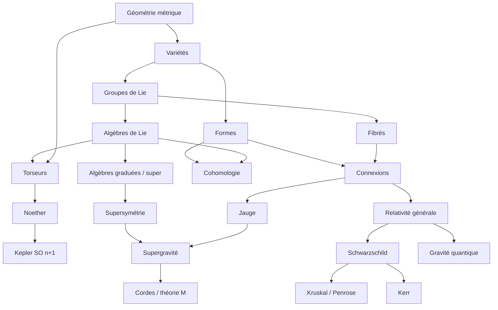

# Mécanique, symétries et géométrie : index

**Fil rouge** : un *torseur* est un élément du dual (type moment) ou de l'algèbre (type vitesse) du groupe euclidien $E(n)$ ; les torseurs de la mécanique sont des **charges de Noether** ; chaque palier élargit le groupe de symétrie : $E(n)\to$ Galilée $\to$ Poincaré $\to$ super-Poincaré $\to$ difféomorphismes/dualités.
Notation : $\doteq$ pour définir, $f\colon X\to Y,\ x\mapsto f(x)$ pour les applications ([[01_Conventions_notations]]).

## Arborescence

```
Mecanique_Symetries_Geometrie/
├── 00_Index.md
├── 99_Errata_des_notes_importees.md
├── 01_Fondations/
│   ├── 01_Conventions_notations
│   ├── 02_Geometrie_metrique_operateurs
│   └── 03_Synthese_pieges_exercices_biblio
├── 02_Mathematiques_structures/
│   ├── 01_Varietes_differentielles
│   ├── 02_Formes_differentielles_calcul_exterieur
│   ├── 03_Fibres
│   ├── 04_Connexions
│   ├── 05_Cohomologie
│   ├── 06_Algebres_de_Lie
│   ├── 07_Groupes_de_Lie
│   ├── 08_Algebres_graduees_ideaux_superalgebres
│   └── 09_Algebres_de_Clifford_spineurs
├── 03_Mecanique_et_torseurs/
│   ├── 01_Cinematique_referentiels_solide
│   ├── 02_Torseurs_Varignon_generalise
│   ├── 03_Dynamique_des_systemes
│   ├── 04_Solide_rigide_inertie
│   ├── 05_Lagrange_Hamilton_Noether
│   ├── 06_Kepler_Runge_Lenz_SO_n+1
│   ├── 07_Collisions_nD
│   └── 08_Statistique_GE_GGE
├── 04_Champs_Jauge_Relativite/
│   ├── 01_Noether_champs_Schrodinger_jauge
│   ├── 02_Relativite_restreinte_Poincare
│   ├── 03_Jauge_EM_YM_Gravite
│   ├── 10_Relativite_generale_equations_Einstein
│   ├── 11_Schwarzschild_trou_noir
│   ├── 12_Coordonnees_EF_Kruskal_Penrose_extension_maximale
│   ├── 13_Kerr_trou_noir_en_rotation
│   └── 14_Kerr_horizons_ergoregion_extension_maximale
└── 05_Au_dela_SUSY_Sugra_GQ_M/
    ├── 01_Supersymetrie
    ├── 02_Supergravite_resume
    ├── 02_Supergravite_connexion_courbure
    ├── 03_Gravitation_quantique
    └── 04_Cordes_et_theorie_M
```

## Parcours de lecture

1. **Mécanique 3D → nD** : [[01_Conventions_notations]] → [[02_Geometrie_metrique_operateurs]] → [[01_Cinematique_referentiels_solide]] → [[02_Torseurs_Varignon_generalise]] → [[03_Dynamique_des_systemes]] → [[04_Solide_rigide_inertie]].
2. **Variationnel et symétries** : [[05_Lagrange_Hamilton_Noether]] → [[06_Kepler_Runge_Lenz_SO_n+1]] → [[07_Collisions_nD]] → [[08_Statistique_GE_GGE]].
3. **Mathématiques structurelles** : [[01_Varietes_differentielles]] → [[02_Formes_differentielles_calcul_exterieur]] → [[07_Groupes_de_Lie]] → [[06_Algebres_de_Lie]] → [[03_Fibres]] → [[04_Connexions]] → [[05_Cohomologie]] ; en parallèle [[08_Algebres_graduees_ideaux_superalgebres]], [[09_Algebres_de_Clifford_spineurs]].
4. **Champs, jauge, gravitation** : [[01_Noether_champs_Schrodinger_jauge]] → [[02_Relativite_restreinte_Poincare]] → [[03_Jauge_EM_YM_Gravite]] → [[10_Relativite_generale_equations_Einstein]] → [[11_Schwarzschild_trou_noir]] → [[12_Coordonnees_EF_Kruskal_Penrose_extension_maximale]] → [[13_Kerr_trou_noir_en_rotation]] → [[14_Kerr_horizons_ergoregion_extension_maximale]].
5. **Au-delà** : [[01_Supersymetrie]] → [[02_Supergravite_resume]] → [[02_Supergravite_connexion_courbure]] → [[03_Gravitation_quantique]] → [[04_Cordes_et_theorie_M]].
6. Synthèse, pièges, exercices : [[03_Synthese_pieges_exercices_biblio]] ; corrections des notes importées : [[99_Errata_des_notes_importees]].

## Graphe de dépendances (Mermaid)


